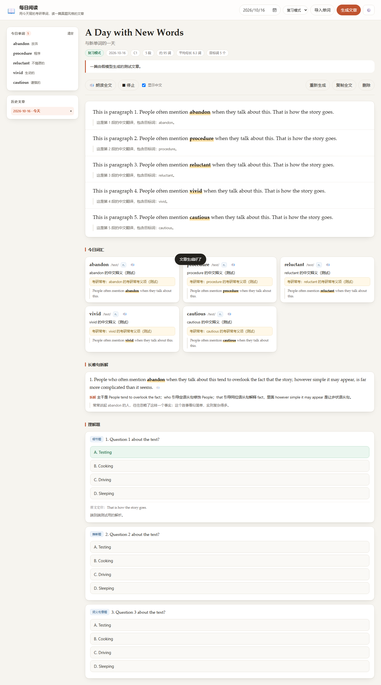
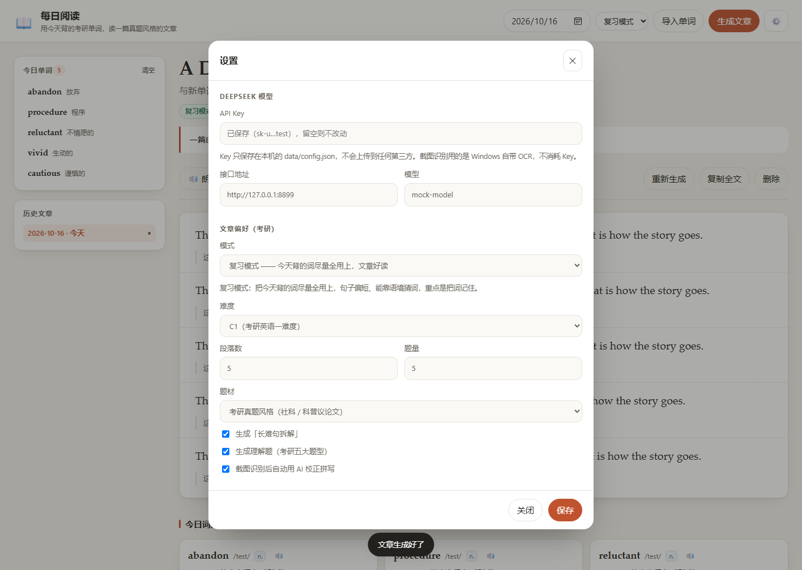

# 每日阅读 · 考研英语

把今天背的单词变成一篇**考研英语阅读真题风格**的文章，配长难句拆解和真题题型。
本地跑，数据全在自己电脑上。



## 快速开始

**双击桌面上的「每日阅读 · 考研英语」图标**（安装时已经给你放好了）。

首次使用：

1. 右上角 **⚙️ 设置** → 填入 DeepSeek API Key（[在这里申请](https://platform.deepseek.com/api_keys)）
2. 点 **导入单词** → **上传百词斩截图**（拖进去，或者 `Ctrl`+`V` 粘贴）
3. 点 **生成文章** → 等半分钟，开始读

快捷方式背后是 `start.cmd`：它会启动本地服务并自动打开浏览器。
**关掉那个黑窗口就是停止服务。**

> 只需要 Node.js 18+ 和 Windows。**不需要 npm install**，没有任何第三方依赖。
>
> 想手动启动：在该目录执行 `node server.js`，然后自己打开 <http://127.0.0.1:8787>（这样不会自动弹浏览器）。
>
> 如果启动时提示端口被占用，说明已经开着一个了 —— 程序会直接把浏览器指向已有实例。
> **改过代码之后一定要先关掉旧的启动窗口再重启**，否则新代码不会生效（Node 会把模块缓存在进程里）。

### start.cmd 为什么必须保持纯 ASCII + CRLF

`cmd.exe` 是按 **ANSI 代码页逐字节**解析 `.cmd` 文件的，不是按 UTF-8。所以：

- `.cmd` 里写中文（UTF-8 无 BOM），配合 `chcp 65001`，会让 cmd 的文件位置指针错位，
  后面的行直接乱掉 —— 曾经把 `echo` 吃成 `ho`、`node server.js` 吃成 `erver.js`，
  双击图标只闪一下报错就退出
- 只有 LF 换行会让 `if (...)` 这类块级语法解析失败

因此 `start.cmd` 里**一个非 ASCII 字符都不能有，而且必须是 CRLF**，
所有中文提示都由 `server.js` 打印。`lib/ocr.ps1` 同理（PowerShell 5.1 按 ANSI 读 `.ps1`）。
测试里有专门的断言守着这两点。

## 每天要做什么

| 步骤 | 操作 | 花多久 |
| --- | --- | --- |
| 1 | 百词斩背完今天的单词，截几张图 | — |
| 2 | 把截图**一次全拖进**阅读器 | 几秒 |
| 3 | 点「开始识别」，勾掉不想要的词 | 几秒 |
| 4 | 点「生成文章」 | 等 30 秒 |
| 5 | 读 | — |

也可以一张一张加：**分几次导入会累加去重，不会互相覆盖**。
第二批如果全是重复词，会提示「新增 0 个，跳过重复 N 个」，词表总数不变。

要推倒重来就点侧栏「今日单词」右上角的**清空**（只清单词，已生成的文章不受影响）。

每生成一篇文章都会存成 `data/articles/日期.json`，左侧「历史文章」随时回看。

## 截图识别怎么做的

用的是 **Windows 系统自带的 OCR**（`Windows.Media.Ocr`）——本地运行，不联网，不需要额外的 API Key，也不算你 DeepSeek 的额度。

**一次可以拖入多张截图**（最多 12 张），识别结果会合并去重。

关键在于**按字号挑词**，而且**每张图各算各的阈值**：

- 百词斩单词卡上，目标单词是屏幕上最大的那行字，例句和界面文字都更小
- OCR 结果里每个词都带着包围盒尺寸，所以只保留最大字号的词，例句里的词和「认识 / 不认识」这类界面文字会自动被滤掉
- 如果整张图字号都差不多（比如单词本的列表页），就退回「全部保留」
- 阈值必须逐图计算：单词卡的大字和列表页的小字混在同一批里时，统一阈值会让大字把小字全部压掉

实测：一张单词卡截图只挑出那一个目标词；一张 6 个词的列表截图能全认出来；两种混着一次传，7 个词全都在。

坏图不会拖垮整批：能认的照常认，认不出来的会单独列出来；如果整批都失败，会直接告诉你失败原因，而不是含糊地说「没识别出单词」。

识别完还会**用 AI 校正一遍拼写、剔除界面噪声**（可在导入弹窗里关掉）：

```
OCR 认成：cautlous  →  自动修正为：cautious
OCR 认成：ViVid     →  自动修正为：vivid
```

候选词列出来之后，**拼写可以直接在输入框里改**，改完再保存。

也可以完全不用截图，切到「手动粘贴」标签，一行一个词粘进去就行。

## 文章长什么样

**两种模式**，在设置里切换。

### 复习模式（默认）

目标是把今天背的词记住：

- 当天的词**尽量全部用上**，自然分布在全文
- 句子偏短偏清晰，能靠语境猜出词义
- 每篇都有：逐段中文翻译（可隐藏）、点词弹释义、🔊 朗读
- 词汇表带**「考研常考」义项**（熟词僻义那一类最容易丢分的地方）
- 长难句拆解 + 理解题

### 真题模式

目标是**像考研英语 Part A 的原文**，不追求词汇覆盖率：

| | 复习模式 | 真题模式 |
| --- | --- | --- |
| 目标词 | 当天全部 | 从词表里挑 12–15 个（可调） |
| 句法 | 短句、好读 | 平均句长 25–30 词，每段至少一个两层以上从句的长句 |
| 结构 | 话题自然展开 | 必须有**让步—反驳**，禁止「现象→科学→历史→对策→升华」模板 |
| 开头 | 随意 | 直接切入现象/数据/观点，禁止故事化虚构开头 |
| 地点 | 真实具体 | 真实具体（禁止「某个大陆城市」这类含糊表述） |
| 语域 | 宽松 | 严格书面语，禁口语化动词（如 trash 当「毁掉」、smuggle 当「偷偷加入」） |
| 题型 | 覆盖不同类别 | 细节题 2–3、推断题 1–2，词义/态度/主旨各不超过 1 |
| 选项 | 常规 | 正确项**必须是同义改写**（不许照抄原文），干扰项按**偷换概念 / 以偏概全 / 过度推断 / 张冠李戴 / 正话反说**设计，并在解析里逐个点名 |

两种模式都会检查每个词是否真的出现在文中。复习模式下没用到的词会在标题下方标出来；真题模式只用到一部分词是正常的，所以不报警，改为显示「本篇用到 12/44 个词」。

模式可以在**顶栏一键切换**，也可以在设置里改：



设置里可以调：模式、难度（考研英语一 / 英语二 / 外刊原文）、段落数、题量、题材（经济、科技、社会、教育、环境、法律…）、长难句开关、题目开关。

## 文件结构

```
bcz-reader/
├─ start.cmd              启动脚本（桌面快捷方式指向它）
├─ icon.ico               桌面快捷方式的图标
├─ server.js              本地 HTTP 服务 + API（零依赖）
├─ tools/
│  ├─ make-icon.ps1       生成 icon.ico
│  └─ install-shortcut.ps1 在桌面创建快捷方式
├─ lib/
│  ├─ store.js            data/ 目录的读写
│  ├─ prompt.js           考研向提示词 + 模型输出校验
│  ├─ deepseek.js         DeepSeek（OpenAI 兼容）调用
│  ├─ ocr.js              截图识别的 Node 封装 + 按字号挑词
│  └─ ocr.ps1             调 Windows.Media.Ocr 的 PowerShell 脚本
├─ public/                前端（原生 HTML/CSS/JS，无需构建）
├─ test/
│  ├─ e2e.js              后端端到端（80 项，含真实 OCR）
│  ├─ ui-check.js         真浏览器驱动 UI（51 项）
│  ├─ mock-llm.js         本地假模型，测试用
│  ├─ make-fixtures.ps1   生成测试用的截图
│  └─ fixtures/           单词卡 / 单词列表两种测试图
└─ data/                  运行时生成，全部是明文 JSON
   ├─ config.json         API Key、文章偏好
   ├─ words/2026-10-16.json
   └─ articles/2026-10-16.json
```

**隐私**：服务只监听 `127.0.0.1`，外网访问不到。API Key 存在本机 `data/config.json`，
接口返回给前端时永远只给掩码（`sk-t…1234`）。截图只在本机做 OCR，不会上传。

## 测试

```bash
node test/e2e.js        # 后端端到端（95 项）：真 OCR + 假模型 + 真 HTTP
node test/ui-check.js   # 真浏览器（Edge/Chrome + CDP）跑完整流程（57 项）并截图
```

两个测试都用本地假模型，不消耗 token、访问外网的次数为零。测试也不会弹浏览器窗口。

### 重新生成图标 / 快捷方式

```powershell
# 生成 icon.ico（多尺寸 DIB，16/24/32/48/64/128/256）
powershell -File tools/make-icon.ps1

# 在桌面创建快捷方式（项目挪了位置就重跑一次）
powershell -File tools/install-shortcut.ps1
```

快捷方式用 `WScript.Shell` 创建，指向 `start.cmd`，工作目录设为项目目录，图标用上面的 `icon.ico`。

> `install-shortcut.ps1` 带 UTF-8 BOM，这是必须的：PowerShell 5.1 读没有 BOM 的 `.ps1` 会按 ANSI 解码，快捷方式名字会变乱码。
> （`.cmd` 和 `.ps1` 的规则相反 —— `start.cmd` 必须**纯 ASCII**，`lib/ocr.ps1` 也必须纯 ASCII。）

## 常见问题

**截图识别说没有 OCR 语言包**：Windows 设置 → 时间和语言 → 语言和区域 → 添加中文（简体）或英语（美国）语言包即可。

**一次导入多张图报错**：已修复。根因是 PowerShell 5.1 的 `ConvertFrom-Json` 按 `-NoEnumerate` 返回整个数组，被 `@(管道)` 包成单个元素，导致只有最后一张图被处理。现在图片路径用 base64(JSON) 直接当参数传给脚本，不落中间文件。

**报「路径中具有非法字符」**：这是旧版 `ocr.js`（写 JSON 列表）和新版 `ocr.ps1`（按行读）对不上造成的，JSON 里的引号被当成了路径的一部分。现在两侧都有版本号握手，对不上会直接提示「请重启服务」，而 `ocr.ps1` 也同时兼容两种列表格式。

**改完代码不生效**：Node 会把 `require` 的模块缓存在进程里，**必须关掉启动窗口重新双击图标**。服务进程里缓存的 `ocr.js` 和磁盘上的 `ocr.ps1` 不一致时，OCR 会报错，现在会明确提示重启。

**导入第二批时第一批的单词没了**：已修复。现在是追加去重，不再是整表覆盖。

**桌面图标是白页**：图标文件本身已验证过（用 Explorer 解析图标所用的 `PrivateExtractIcons` 能正确取出）。如果仍显示白页，是 Windows 图标缓存的问题，执行下面任一操作：

```powershell
ie4uinit.exe -show          # 用户级刷新图标缓存，然后在桌面按 F5
```
实在不行就重启一次资源管理器（任务管理器 → Windows 资源管理器 → 重新启动）。

**快捷方式点了闪一下就没了**：那是 `start.cmd` 本身报错退出了。该文件必须是纯 ASCII + CRLF（见上面的说明），改它的时候别加中文。

**OCR 认错了词**：候选词可以逐个手改；也可以把「用 AI 校正拼写」勾上（默认开）。

**截图识别不出词**：确认截图里单词本身清晰、没被裁掉。单词卡截图效果最好；整屏的单词列表也能认。识别结果下方有一份「原始识别文字」，可以对照看看 OCR 到底读到了什么。

**生成时报 401 / 402**：API Key 不对或余额不足，去设置里重填。

**生成很慢**：一次要写 6 段英文加翻译、长难句和新题型，通常 30~60 秒，属正常。

**想换别的模型**：设置里的「接口地址 + 模型」支持任何 OpenAI 兼容服务（如 `https://api.openai.com/v1`、本地 Ollama、One-API 中转）。

**端口被占用**：`set PORT=9000 && node server.js`。
